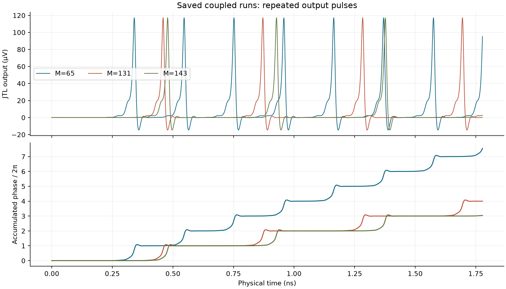

# Long Josephson Junction · JTL

ВАХ и спектры длинного джозефсоновского перехода, а также передача SFQ-импульсов в пятиэлементную джозефсоновскую линию через ёмкостную связь.



## Результаты

- Для связанного запуска `M=65` частота повторения выходных импульсов составляет около **4.86 GHz**; площадь полных импульсов близка к одному кванту потока.
- Для отдельного LJJ в точке `i=0.62` получено `V=20.7186 µV` и `f_J=10.0195 GHz`. Однофлюксонная оценка `f_J/2` близка к 5 GHz.
- Самый сильный сохранённый спектральный пик около 5.1 GHz относится к более высокой ветви ВАХ. Оценка на условных 50 Ω не является измеренной излучаемой мощностью.
- Повторный расчёт воспроизвёл выбранный сохранённый сигнал; контроли без флюксона и без связи не дали выходных SFQ-импульсов.

[Отчёт PDF](docs/review_2026-11-23/report.pdf) · [Подробные научные заметки](docs/research-notes.md) · [Таблицы и проверки](docs/review_2026-11-23/)

## Быстрый старт

```bash
python3 -m venv .venv
source .venv/bin/activate
python -m pip install -r requirements.txt
# Новый расчёт связанной системы:
python ljj_capacitive_jtl_final_calculated_params.py

# ВАХ и спектр отдельного перехода:
python IV_only_main_axes_higher_heatmap_resolution.py
```

В связанном скрипте параметры задаются словарём `P`, в скриптах ВАХ — нижним блоком настройки. По умолчанию открываются интерактивные графики и сохраняется GIF. Полная серия ВАХ включает 241 точку тока и может занять заметное время.

## Содержимое

| Путь | Назначение |
|---|---|
| `ljj_capacitive_jtl_*.py` | Три версии связанной модели LJJ–JTL |
| `IV_*.py` | Три версии расчёта ВАХ и спектров отдельного LJJ |
| [iv_fluxon_results/](iv_fluxon_results/) | Сохранённые ВАХ, FFT-карты и CSV/NPZ |
| [ljj_capacitive_jtl_results/](ljj_capacitive_jtl_results/) | Параметры, выходные сигналы, графики и анимации семи запусков |
| [figures/](figures/) | Исходные обзорные изображения |
| [docs/](docs/) | Отчёт, научные заметки и анализ |

## Повторный анализ

```bash
python docs/review_2026-11-23/analyze_results.py
python docs/review_2026-11-23/validate_coupled.py
```

Физические масштабы разных версий различаются. Для каждого связанного запуска используйте его `parameters.json`; обозначение 5 GHz в имени файла само по себе не устанавливает полученную частоту. Подробные форматы CSV/NPZ, нормировки и ограничения описаны в [научных заметках](docs/research-notes.md).

## Связанные проекты

[Магнитное поле](https://github.com/asfdqyz/long-josephson-junction-field) · [Флюксоны](https://github.com/asfdqyz/long-josephson-junction-fluxons) · [LJJ + JTL](https://github.com/asfdqyz/long-josephson-junction-jtl) · [Топология LJJ](https://github.com/asfdqyz/long-josephson-junction-chip) · [LC-резонатор](https://github.com/asfdqyz/josephson-lc-resonator)
