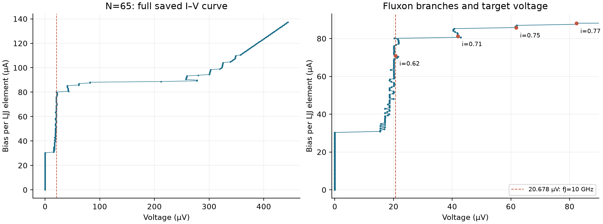

# Long Josephson Junction & Josephson Transmission Line

Численное моделирование длинного джозефсоновского перехода (LJJ), его вольт-амперных характеристик и спектра напряжения, а также передачи импульсов в джозефсоновскую линию (JTL) через ёмкостную связь.

Проект содержит исследовательские скрипты и сохранённые результаты нескольких версий модели. Это расчёты детерминированной модели, а не экспериментальные измерения.

## Что получено

- В расчётах отдельного LJJ с `N=65`, `alpha=0.2`, `l=0.1` есть низковольтная ветвь около 20 µV. В сохранённой точке `i=0.62` получено `V=20.7186 µV`, то есть `f_J=10.0195 GHz`. Оценка `f_J/2=5.00974 GHz` относится к однофлюксонной интерпретации первой ступени.
- Наибольшее сохранённое значение спектра граничного напряжения приходится на `i=0.77`, частоту FFT `5.09985 GHz` и составляет `2.00317e-10 W` при пересчёте на условные 50 Ω. Эта точка уже находится на более высокой ветви ВАХ: `V=82.3724 µV`. Её нельзя выдавать за максимум мощности первой ступени.
- В связанной системе с `M=65`, пятью элементами JTL и `kappa=2` наблюдается серия выходных импульсов с частотой примерно **4.86 GHz**. Изменение фазы за полные внутренние периоды соответствует площади импульса около **одного кванта потока**.
- Повторный расчёт одного сохранённого запуска воспроизвёл выходной сигнал. В контрольных расчётах без начального флюксона и без ёмкостной связи выходных SFQ-импульсов не обнаружено за то же время наблюдения.

Подробности, ограничения и количественные таблицы: [отчёт PDF](review_2026-11-23/report.pdf), [машиночитаемые результаты анализа](review_2026-11-23/metrics.json), [контрольные расчёты](review_2026-11-23/validation.json).



## Модель и единицы

В основе лежит открытая цепочка RCSJ-элементов с индуктивной связью. Для внутренних узлов LJJ:

```text
phi_k'' + alpha * phi_k' + sin(phi_k)
    = i + (phi_(k+1) + phi_(k-1) - 2*phi_k) / l
```

Штрих обозначает производную по `tau = omega_p * t`. На свободных концах используется односторонняя разность. Флюксон задаётся начальным фазовым профилем; в основных скриптах ВАХ внешний поток равен нулю.

Связь правого конца LJJ и первого элемента JTL задаётся матрицей ёмкостей:

```text
(1 + kappa) * phi_edge'' - kappa * theta_1'' = F
-kappa * phi_edge'' + (m_J + kappa) * theta_1'' = G
```

Здесь `m_J = C_J / C_L`, `s_J = Ic_J / Ic_L`, `kappa = C_c / C_L`. Все токи в связанной модели нормированы на `Ic_L`.

Для поздней версии с `Jc=0.1 kA/cm²`, `Cs=0.06 pF/µm²`:

| Величина | Значение / соотношение |
|---|---|
| Плазменная частота `f_p` | около 35.816 GHz |
| Масштаб напряжения | около 74.061 µV на единицу `phi'` |
| Физическое время | `t = tau / omega_p` |
| Частота Джозефсона | `f_J = V / Phi0` |
| Спектральная частота FFT | `f_Hz = f_tau * omega_p` |
| Площадь импульса | `integral(V dt) / Phi0 = Delta(theta) / (2*pi)` |

**Частота Джозефсона, частота возвращения флюксона и частота максимума FFT - разные величины.** Оценка `f_rad = f_J/2` применима к выбранной интерпретации первой однофлюксонной ступени. На других ветвях нужно анализировать временной сигнал и спектр. В CSV столбец `radiation_frequency_GHz_Nfl_1` вычисляется именно как `f_J/2`, а не измеряется независимо.

## Файлы проекта

| Файл / папка | Назначение |
|---|---|
| `IV_only_main_axes_higher_heatmap_resolution.py` | ВАХ и спектр отдельного LJJ; текущая сетка тока `di=0.005`, `N=65` |
| `IV_radiation_5GHz_spectrum_heatmap_power_W.py` | Близкий вариант с `di=0.01` и другим оформлением графиков |
| `IV_characteristics_long_jj_physical_output_5GHz.py` | Более ранний расчёт ВАХ; текущий `N=131`, без спектральной карты |
| `ljj_capacitive_jtl_final_calculated_params.py` | Связанная LJJ–JTL; `M=65`, начальная ячейка 10, площадь элемента 114.43 µm² |
| `ljj_capacitive_jtl_josephson_5GHz_option1.py` | Более ранний вариант; текущая площадь 115 µm² и начальная ячейка 20 |
| `ljj_capacitive_jtl_param_folders.py` | Ранний масштаб с `C_L=60 fF`; физические единицы отличаются от поздних версий |
| `iv_fluxon_results/` | 13 таблиц ВАХ, пять архивов спектров NPZ, таблицы спектральных максимумов и графики |
| `ljj_capacitive_jtl_results/` | Семь запусков с параметрами, CSV выхода JTL, графиками и анимациями |
| `review_2026-11-23/` | Отчёт, повторный анализ, контрольные расчёты, таблицы и сводные рисунки |

Названия файлов отражают историю подбора параметров. Они не гарантируют, что полученная частота равна 5 GHz. Для связанных запусков параметры и физические масштабы следует брать из `parameters.json` соответствующей папки.

## Запуск

Нужен Python 3 с пакетами NumPy, SciPy, Matplotlib и Pillow. Примеры ниже рассчитаны на запуск из корня проекта. Исходные вычислительные скрипты в ходе подготовки отчёта не изменялись.

```bash
python3 -m venv .venv
source .venv/bin/activate
python -m pip install numpy scipy matplotlib pillow

# Повторно обработать сохранённые результаты и построить сводные графики:
python docs/review_2026-11-23/analyze_results.py

# Воспроизвести один связанный запуск и выполнить три контроля:
python docs/review_2026-11-23/validate_coupled.py

# Новый расчёт связанной системы:
python ljj_capacitive_jtl_final_calculated_params.py

# Полная новая серия ВАХ и спектров:
python IV_only_main_axes_higher_heatmap_resolution.py
```

Вычислительные параметры задаются внутри файлов: словарь `P` у связанной модели и блок `if __name__ == "__main__"` у ВАХ. Полный расчёт ВАХ включает 241 значение тока с интегрированием до `tau=1500` в каждой точке и может занять заметное время.

Графики по умолчанию открываются интерактивно. В связанном скрипте можно установить `show_plots=False` и `save_animation=False`; для запуска без графического интерфейса подходит backend Matplotlib `Agg`. ВАХ сохраняется в папку относительно текущего рабочего каталога, а связанные запуски - рядом с исходным скриптом.

У ВАХ стоит `reset_each_current=True`: каждая точка начинается с одного и того же начального состояния. Это не расчёт непрерывного подъёма тока с переносом конечного состояния и не исследование петли гистерезиса.

## Форматы результатов

**ВАХ CSV:** `I_cell_uA` - ток одного дискретного элемента; `I_total_mA` - ток по принятой геометрической площади; `J_bias_A_per_cm2` - плотность тока; `V_uV_Nfl_1` - усреднённое напряжение; далее частоты. Самая ранняя таблица содержит нормированные величины.

**Спектр NPZ:** сетки `currents_norm`, `frequency_GHz`, токи, `power_W`, максимумы и сопротивление нагрузки. Ранний файл `20260617_133029` содержит `power` в нормированных единицах и `power_dB_row_normalized`, а не мощность в ваттах. Данные загружаются через `numpy.load(..., allow_pickle=False)`.

**Выход JTL CSV:** `tau`, `V_out_normalized`, `V_out_mV`, `Delta_theta_N_over_2pi`. Последний столбец - накопленное изменение фазы на выходе; дробное значение в конце записи может соответствовать незавершённому импульсу.

## Границы интерпретации

- `power_W` - оценка через квадрат спектрального напряжения на условном сопротивлении 50 Ω. В модели отдельного LJJ нет согласованной выходной нагрузки или антенны, поэтому это не доказанная излучаемая либо реально отданная в нагрузку мощность.
- FFT использует окно Ханна и нормировку амплитуды. Значения спектра нельзя просто суммировать как независимые мощности частотных интервалов без поправки на окно. Частотный шаг сохранённых карт около 0.300 GHz; повышение DPI его не улучшает.
- Обозначение `Nfl_1` относится к начальному профилю. Число возбуждений в открытой цепи не обязано сохраняться. При начальном центре в ячейке 1 часть хвоста профиля находится за левой границей.
- Повторные имена файлов не всегда означают независимые расчёты: обнаружены точные дубликаты CSV; два последних спектра `N65` также совпадают численно.
- Старый связанный запуск `M100` имеет плазменную частоту около 358 GHz вместо 35.8 GHz. Его физические времена и напряжения нельзя сравнивать с поздними без учёта `physical_scales`.
- Контроли подтверждают один выбранный детерминированный режим на конечном интервале. Здесь нет статистики ошибок, теплового шума, разброса параметров, полной проверки по шагу пространственной сетки или экспериментальной валидации.

## Материалы анализа

В [metrics.json](review_2026-11-23/metrics.json) собраны численные выводы. Таблицы `iv_summary.csv`, `jtl_summary.csv`, `spectrum_summary.csv` и `selected_operating_points.csv` сохраняют показатели каждого запуска. [input_manifest.csv](review_2026-11-23/input_manifest.csv) содержит пути, размеры и SHA-256 исследованных файлов.

Для построения PDF из подготовленного сценария дополнительно нужны `reportlab`, `pypdf` и шрифт Arial с кириллицей; повторный анализ сам PDF не перестраивает. Проверенные версии пакетов анализа записаны в `metrics.json`.

Теоретические соотношения сверены с [NIST: Quantum Locking Ranges](https://www.nist.gov/ctl/rf-technology-division/superconductive-electronics-group/quantum-locking-ranges), а различие спектра и спектральной плотности - с [документацией SciPy periodogram](https://docs.scipy.org/doc/scipy/reference/generated/scipy.signal.periodogram.html). Численные результаты приведены по локальным данным проекта.

Лицензия в исходной папке не задана; условия распространения должен выбрать автор.
